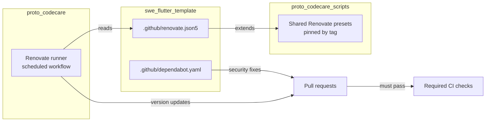

# Swe Flutter Template

![coverage][coverage_badge]
[![style: very good analysis][very_good_analysis_badge]][very_good_analysis_link]
[![License: MIT][license_badge]][license_link]

Generated by the [Very Good CLI][very_good_cli_link] 🤖

SWE Flutter App Template

---

## Getting Started 🚀

This project contains 3 flavors:

- development
- staging
- production

To run the desired flavor either use the launch configuration in VSCode/Android Studio or use the following commands:

```sh
# Development
$ flutter run --flavor development --target lib/main_development.dart

# Staging
$ flutter run --flavor staging --target lib/main_staging.dart

# Production
$ flutter run --flavor production --target lib/main_production.dart
```

_\*Swe Flutter Template works on iOS, Android, Web, and Windows._

---

## Running Tests 🧪

To run all unit and widget tests use the following command:

```sh
$ very_good test --coverage --test-randomize-ordering-seed random
```

To view the generated coverage report you can use [lcov](https://github.com/linux-test-project/lcov).

```sh
# Generate Coverage Report
$ genhtml coverage/lcov.info -o coverage/

# Open Coverage Report
$ open coverage/index.html
```

---

## Dependency Updates 🤖

[Renovate][renovate_link] opens routine dependency update PRs. Dependabot only opens security fixes. The Renovate runner and the shared rules live in two other repos; this repo only holds `.github/renovate.json5` and `.github/dependabot.yaml`.



### Who updates what

| What | Updated by | Notes |
|---|---|---|
| Pub packages (root and `packages/*`) | Renovate | Exact pins. `pubspec.lock` is regenerated in the same PR |
| Flutter SDK (`environment.flutter`) | Renovate, one PR on `renovate/dart-and-flutter-sdk` | The same PR sets Dart (`environment.sdk`) to the version bundled with that Flutter, and AGP, the Kotlin plugin and the Gradle wrapper to Flutter's template versions. Never merged automatically |
| Other Gradle plugins and libraries (e.g. Firebase plugins) | Renovate | AGP, Kotlin (`org.jetbrains.kotlin*`) and the wrapper are excluded: they follow Flutter. Kotlin add-on plugins (`org.jetbrains.kotlin.plugin.*`), if you add any, need a manual bump alongside Kotlin |
| GitHub Actions | Renovate | Including the preset tags in `.github/renovate.json5` |
| Security fixes (pub, GitHub Actions) | Dependabot | PR titles `vulnerability(deps): ...` |
| `swe_design_system` | Nobody | Local workspace package |

### What to expect

- PRs open before 6am Asia/Jakarta (the runner runs on Mondays and Thursdays), once a release is 7 days old.
- Only `mocktail` patches, packages in the shared allowlist and patch releases of the shared presets automerge. Everything else waits for review.
- Nothing merges before the required checks pass. `lockfile-check` fails when `pubspec.lock` is out of date.
- Titles are `fix(deps): ...` for runtime dependencies and `chore(deps): ...` for dev dependencies and tooling.
- The **Dependency Dashboard** issue lists pending updates. Tick a box to get a PR early; it's created on the next runner run.
- CI doesn't build Android yet. Build Flutter SDK and Gradle PRs locally before merging:
  `flutter build apk --flavor development -t lib/main_development.dart`.

Rules and their reasons: [shared presets][renovate_presets_link]. Runner: [proto_codecare][renovate_runner_link]. Rules for this repo only go in `.github/renovate.json5`.

### New repo from this template

A repo created from this template gets the files, not the settings or the Renovate App access. After creating it:

1. Add the repo to the Renovate App: [GitHub App installations][github_installations_link] → the Renovate App → **Configure** → **Repository access** → select the new repo → **Save**.
2. Apply the repo settings (Dependabot security updates, rulesets, required checks) with [`setup-github-repo.sh`][setup_github_repo_link].
3. If you rename the `swe_design_system` package, update `ignoreDeps` in `.github/renovate.json5`.
4. Run the [Renovate workflow][renovate_workflow_link] (**Run workflow**) or wait for the next run. The Dependency Dashboard issue appears in the new repo.

These steps work only on the template owner's account: the Renovate App can't be installed elsewhere. On another account, run your own self-hosted Renovate:

- [Self-hosting Renovate][renovate_self_hosting_link], using a [GitHub App][github_app_link] as the bot.
- Schedule it with [renovatebot/github-action][renovate_action_link]. The [proto_codecare runner][renovate_runner_link] is a working example.
- Allow the Flutter SDK sync commands via [`allowedCommands`][renovate_allowed_commands_link]. The list to copy is in the [runner config][renovate_runner_config_link].

Without a Renovate runner, delete `.github/renovate.json5`. Dependabot security fixes keep working.

---

## Bloc Lints 🔍

This project uses the [bloc_lint](https://pub.dev/packages/bloc_lint) package to enforce best practices using [bloc](https://pub.dev/packages/bloc).

To validate linter errors, run

```bash
dart run bloc_tools:bloc lint .
```

You can also validate with VSCode-based IDEs using the [official bloc extension](https://marketplace.visualstudio.com/items?itemName=FelixAngelov.bloc).

To learn more, visit https://bloclibrary.dev/lint/

---

## Working with Translations 🌐

This project follows the [official internationalization guide for Flutter][internationalization_link] using [ARB files][arb_documentation_link] for translations.

### Adding Strings

1. To add a new localizable string, open the `app_en.arb` file at `lib/l10n/arb/app_en.arb` and add a new key/value pair with the relevant description (optional):

```arb
{
    "@@locale": "en",
    "counterAppBarTitle": "Counter",
    "@counterAppBarTitle": {
        "description": "Text shown in the AppBar of the Counter Page"
    },
    "helloWorld": "Hello World",
    "@helloWorld": {
        "description": "Hello World greeting."
    }
}
```

1. Use the new string:

```dart
import 'package:swe_flutter_template/l10n/l10n.dart';

@override
Widget build(BuildContext context) {
  final l10n = context.l10n;
  return Text(l10n.helloWorld);
}
```

### Adding Supported Locales

Update the `CFBundleLocalizations` array in the `Info.plist` at `ios/Runner/Info.plist` to include the new locale.

```xml
    ...

    <key>CFBundleLocalizations</key>
	<array>
		<string>en</string>
		<string>es</string>
	</array>

    ...
```

### Adding Translations

1. For each supported locale, add a new ARB file in `lib/l10n/arb`:

```
├── l10n
│   ├── arb
│   │   ├── app_en.arb
│   │   └── app_es.arb
```

1. Add the translated strings to the new `.arb` file:

`app_es.arb`

```arb
{
    "@@locale": "es",
    "counterAppBarTitle": "Contador",
    "@counterAppBarTitle": {
        "description": "Texto mostrado en la AppBar de la página del contador"
    },
    "helloWorld": "Hola Mundo",
    "@helloWorld": {
        "description": "Saludo Hola Mundo."
    }    
}
```

### Generating Translations

To use the latest translations changes, you will need to generate them:

```sh
flutter gen-l10n --arb-dir="lib/l10n/arb"
```

Alternatively, run `flutter run` and code generation will take place automatically.

[coverage_badge]: coverage_badge.svg
[github_app_link]: https://docs.github.com/en/apps/creating-github-apps/registering-a-github-app/registering-a-github-app
[github_installations_link]: https://github.com/settings/installations
[renovate_action_link]: https://github.com/renovatebot/github-action#example-with-github-app
[renovate_allowed_commands_link]: https://docs.renovatebot.com/self-hosted-configuration/#allowedcommands
[renovate_link]: https://docs.renovatebot.com/
[renovate_presets_link]: https://github.com/ekawijayasusilo/proto_codecare_scripts/tree/main/version-control/renovate-configs
[renovate_runner_config_link]: https://github.com/ekawijayasusilo/proto_codecare_scripts/blob/main/version-control/renovate-configs/runner.json
[renovate_runner_link]: https://github.com/ekawijayasusilo/proto_codecare#renovate-runner
[renovate_self_hosting_link]: https://docs.renovatebot.com/getting-started/running/#self-hosting-renovate
[renovate_workflow_link]: https://github.com/ekawijayasusilo/proto_codecare/actions/workflows/renovate.yml
[setup_github_repo_link]: https://github.com/ekawijayasusilo/proto_codecare_scripts/tree/main/version-control/github-setup-repo
[internationalization_link]: https://docs.flutter.dev/ui/internationalization
[arb_documentation_link]: https://github.com/google/app-resource-bundle
[license_badge]: https://img.shields.io/badge/license-MIT-blue.svg
[license_link]: https://opensource.org/licenses/MIT
[very_good_analysis_badge]: https://img.shields.io/badge/style-very_good_analysis-B22C89.svg
[very_good_analysis_link]: https://pub.dev/packages/very_good_analysis
[very_good_cli_link]: https://github.com/VeryGoodOpenSource/very_good_cli
